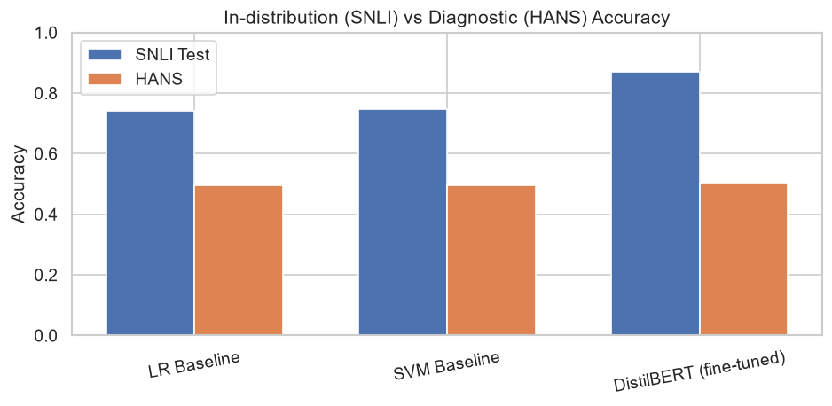
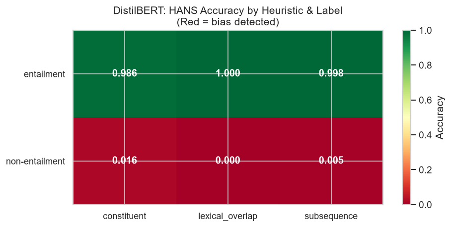

# Heuristic Bias Diagnosis in NLI Models

Do natural language inference (NLI) models actually reason, or do they take shortcuts? This project trains models on **SNLI** and tests them on **HANS**, a diagnostic benchmark built to catch three surface heuristics:

| Heuristic | The shortcut | Example the shortcut gets wrong |
|---|---|---|
| Lexical overlap | "All the hypothesis words appear in the premise → entailment" | *The doctor was paid by the actor.* ↛ *The doctor paid the actor.* |
| Subsequence | "The hypothesis is a contiguous chunk of the premise → entailment" | *The doctor near the actor danced.* ↛ *The actor danced.* |
| Constituent | "The hypothesis is a sub-clause of the premise → entailment" | *If the artist slept, the actor ran.* ↛ *The artist slept.* |

A model that scores well on SNLI but fails the non-entailment cases in HANS is relying on these shortcuts rather than on sentence meaning.

## Approach

1. **Data:** SNLI (570k pairs) mapped to two classes (entailment vs non-entailment) to match HANS; balanced 10,000-pair training subset (seed 42). HANS (30,000 pairs) is **evaluation only** and never seen in training.
2. **Baselines:** TF-IDF (word + bigram) with Logistic Regression and with Linear SVM.
3. **Transformer:** `distilbert-base-uncased` fine-tuned for 3 epochs (AdamW, lr 2e-5, max length 128).
4. **Diagnosis:** accuracy on SNLI test vs HANS, broken down by heuristic, gold label and HANS subcase; confusion matrices; error analysis with concrete failure examples.

## Results

**DistilBERT reaches 87.0% on SNLI but only 50.1% on HANS, which is chance level.** It labelled 14,892 of the 15,000 HANS non-entailment pairs as "entailment": it has learned that shared words mean entailment rather than learning what the sentences mean.

| Model | SNLI test accuracy | HANS accuracy |
|---|---|---|
| TF-IDF + Logistic Regression | 74.0% | 49.7% |
| TF-IDF + Linear SVM | 74.7% | 49.5% |
| DistilBERT (fine-tuned on SNLI) | **87.0%** | **50.1%** |



DistilBERT's HANS accuracy split by heuristic and gold label: near-perfect when the shortcut points to the right answer (entailment) and near zero when it doesn't (non-entailment).

| Heuristic | Entailment | Non-entailment |
|---|---|---|
| Lexical overlap | 100.0% | 0.0% |
| Subsequence | 99.8% | 0.5% |
| Constituent | 98.6% | 1.6% |



Results come from a single run (seed 42) on CPU: 3 epochs, best validation accuracy 87.8%.

## Run it

```bash
pip install -r requirements.txt
python nli_heuristic_bias.py
```

The script is split into `# %% CELL N` blocks, so it also runs cell by cell in Jupyter, VS Code or Google Colab. A GPU is recommended for the DistilBERT step. Datasets download automatically from Hugging Face; figures, results and model checkpoints are written to `figures/`, `results/` and `models/`.

## Future work

- MNLI → SNLI transfer comparison
- Robustness training with HANS-style counterexamples (on a held-out split)
- Attention and LIME interpretability analysis
- Bootstrap confidence intervals and significance tests

## References

- Bowman et al., 2015. *A large annotated corpus for learning natural language inference.* EMNLP.
- McCoy, Pavlick and Linzen, 2019. *Right for the Wrong Reasons: Diagnosing Syntactic Heuristics in Natural Language Inference.* ACL. ([HANS dataset](https://github.com/tommccoy1/hans))
- Sanh et al., 2019. *DistilBERT, a distilled version of BERT.* arXiv:1910.01108.

## Author

**Abubakar Umar Dangi**, MSc Data Science, University of Europe for Applied Sciences, Berlin
